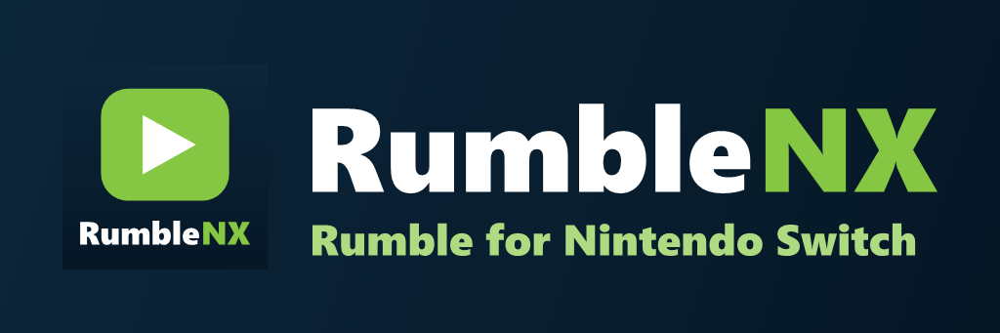

<p align="center">
  
</p>

<p align="center">
  <strong>A controller-first Rumble client for Nintendo Switch homebrew.</strong>
</p>

<p align="center">
  
  
  
  <a href="LICENSE"></a>
</p>

<p align="center">
  A Rumble port of <a href="https://github.com/j2k-lab/kickNX">kickNX</a> by <strong>j2k</strong>
</p>

## About

**RumbleNX** is an independent [Rumble](https://rumble.com) client for
Nintendo Switch homebrew. It keeps kickNX's native MPV playback, controller
and touch navigation, portrait mode and chat composer, and replaces
everything Kick-specific with Rumble: browsing, search, channels, live
streams, videos, live chat with rants, and Rumble sign-in.

## Features

### Browse Rumble

- **Home:** Live now, Editor picks, Trending today and Rumble's categories,
  each a horizontal row that loads more pages as you scroll
- A hero panel previews the focused video or stream
- **Search** (Y) for videos and channels
- **Categories** open their live streams, or the category's recent videos
  when nobody is live
- **Following:** follow channels from their pages; Home shows a "Following ·
  live now" row and every followed channel
- **Import follows:** once signed in, copy the channels your Rumble account
  follows into RumbleNX

### Channel pages

- Banner, avatar, follower count, verified state and description
- Live and scheduled streams first, then every video, page by page
- Watch live, Follow / Following and Refresh buttons
- Works for both `rumble.com/c/…` channels and `rumble.com/user/…` pages

### Playback

- Live streams (with DVR where the stream offers it), past broadcasts and
  uploads, played from Rumble's HLS playlists
- Quality selection: Auto, 1080p, 720p, 480p or 360p
- Subtitles on videos that have them
- Scheduled streams show when they start instead of failing to play
- Software, Hardware and Hybrid decoder modes, with kickNX's guarded
  FFmpeg/NVTEGRA build
- Fullscreen, docked-chat and overlay-chat layouts
- Live streams that end are detected and the player returns to the previous
  screen

### Live chat

- Real-time Rumble chat, including rants with their tier colours, mentions,
  username colours and messages removed by moderators
- Rumble emotes (`:r+rumblerocket:` and channel emotes) drawn inline, with
  animated GIF emotes playing
- Docked chat, full-height overlay or compact overlay in any of four corners
- **Send messages** when signed in, from the built-in on-screen keyboard
  (with an emoji picker that remembers recent emoji) or the Nintendo keyboard
- Rumble's 200-character limit and send cooldown are respected

### Account

- Sign in with your Rumble username (or e-mail) and password
- Two-factor sign-in by e-mail code, text message code or authenticator app
- The password is sent only to rumble.com, as Rumble's own salted hash, and is
  never stored; only the session is kept on the SD card until you sign out

### Interface

- OLED, Dark Grey and Rumble colour themes from the Theme button on Home
- D-pad / left stick for focus, right stick for scrolling long pages
- Portrait mode from the Joy-Con motion sensors, with stream, chat and
  keyboard on one screen
- Touchscreen support throughout

## Installation

1. Download `RumbleNX.nro` from the
   [releases page](https://github.com/j2k-lab/rumbleNX/releases), or build it
   yourself (see [Building](#building-from-source)).
2. Copy it to the SD card:

   ```text
   /switch/RumbleNX/RumbleNX.nro
   ```

3. Launch RumbleNX from the Homebrew Menu. Launching through a title (holding
   R while starting a game) gives the app the full memory it needs; applet
   mode shows a reminder first.
4. Browse as a guest, or choose **Sign in** to chat and import follows.

## Files on the SD card

| Path | Contents |
| --- | --- |
| `/config/RumbleNX/settings.json` | Quality, decoder and chat preferences |
| `/config/RumbleNX/session.json` | Your Rumble session while signed in (deleted on sign-out) |
| `/config/RumbleNX/follows.json` | Channels you follow in RumbleNX |
| `/config/RumbleNX/orientation.json`, `haptics.json` | Portrait-mode and keyboard-haptics settings |
| `/switch/RumbleNX/config.json` | Colour theme and app configuration |

RumbleNX updates itself. A few seconds after it starts it checks GitHub for a
newer release and offers to install it; **About → Check for updates** does
the same on request, and **Check at startup** turns the automatic check off.
The new NRO is downloaded next to the old one, checked against the size and
SHA-256 checksum GitHub publishes, swapped in, and RumbleNX restarts. Updating
by hand (replacing the NRO) works too. Your settings files are kept either way.

## Decoder modes

- **Software:** CPU decoding, the most compatible.
- **Hardware:** NVTEGRA decoding with kickNX's frame, reference and transfer
  guards.
- **Hybrid (default):** hardware decoding with software recovery during
  disruptive playback transitions.

## How RumbleNX talks to Rumble

Rumble has no public API for third-party apps, so RumbleNX uses the same
public endpoints as Rumble's website and embeds:

- Listing pages (`/browse/live`, `/editor-picks`, `/videos`, `/browse`,
  `/category/…`, `/search/…`, channel pages) for browsing
- The embed service (`/embedJS/u3/`) for playback URLs, live state and
  subtitles
- The chat stream (`web7.rumble.com/chat/api/chat/<id>/stream`) for live chat
- Rumble's `service.php` sign-in and the chat message endpoint for signed-in
  features

Every request identifies itself honestly as
`RumbleNX/<version> (Nintendo Switch homebrew)`.

## Known limitations

- Rumble can change its pages or services at any time, which can break
  browsing, playback or chat until RumbleNX is updated.
- **Following is local.** Rumble's follow button has no documented API, so
  follows are stored on the SD card. *Import follows* reads the
  subscriptions page of your account and may stop working if Rumble changes
  that page.
- Sending rants (paid messages) is not supported; rants from others are shown.
- Rumble serves some pages behind Cloudflare. If Rumble challenges a request,
  the affected row shows an error with a Retry button; RumbleNX does not try
  to bypass these checks.
- Like kickNX, TLS certificate verification is disabled for HTTPS requests
  (the Switch has no system CA bundle in this build). Connections are
  encrypted but the server is not authenticated. That includes update
  downloads: the checksum comes over the same connection, so it catches
  corrupted downloads rather than a deliberate network attack.
- Chat timestamps are shown in UTC.
- Self-updating needs RumbleNX to be started from the Homebrew Menu as an
  NRO on the SD card; other launch methods get a link to the releases page.
- Only the Nintendo Switch build is maintained; the desktop and other
  platform packaging inherited from Switchfin is untested.

## Building from source

See [BUILDING.md](BUILDING.md) for the guarded FFmpeg recipe, the Docker
image and the build commands. In short, after preparing FFmpeg:

```powershell
docker build -t rumblenx-switch-builder .
docker run --rm -v "${PWD}:/workspace" -w /workspace rumblenx-switch-builder bash build-switch.sh
```

The output is `build_switch/RumbleNX.nro`.

## Credits

- **j2k** (with Gemini and Claude) - kickNX, which RumbleNX is ported from
- **twiNX developer HiroshiYamauchi** - kickNX's upstream client foundation
- **Switchfin contributors** - original Nintendo Switch UI, player and platform base
- **Borealis contributors** - controller-first UI framework
- **yt-dlp and cocorum contributors** - public documentation of Rumble's embed,
  chat and sign-in services
- **mpv, FFmpeg, libcurl, LunaSVG, nlohmann/json, Noto Emoji, libnx and
  devkitPro contributors**

Full attribution is in [THIRD_PARTY_NOTICES.md](THIRD_PARTY_NOTICES.md).

## License

RumbleNX is distributed under **GPL-3.0-only**, like kickNX. Inherited and
third-party files keep their original licenses and copyright notices. See
[LICENSE](LICENSE), [LICENSES](LICENSES/) and
[THIRD_PARTY_NOTICES.md](THIRD_PARTY_NOTICES.md).

## Disclaimer

RumbleNX is an independent, unofficial homebrew project. It is not affiliated
with, endorsed by or sponsored by Rumble Inc., Kick or Nintendo. Product
names and trademarks belong to their respective owners.
